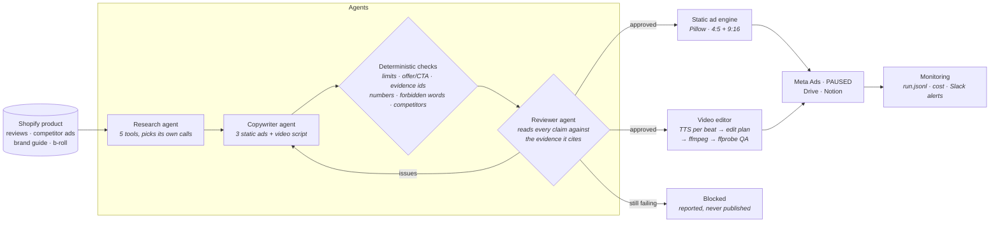

# ecom-ai-studio

[](https://github.com/cainticjohncarlo-pixel/ecom-ai-studio/actions/workflows/tests.yml)

AI creative pipeline for e-commerce brands, in Python. A **research agent** studies the product, its reviews and competitor ads with tools; a **copywriter agent** writes static ads and a video script; a **reviewer agent checks the other agents' work** against the evidence; then a **static ad engine** renders the approved ads and a **video editor** cuts a vertical ad from voiceover and b-roll with ffmpeg. Approved ads go to Meta as paused drafts, files to Drive, rows to Notion, and every run is monitored with alerts to Slack.

**One real run, committed:** [`output/sample_run/REPORT.md`](output/sample_run/REPORT.md) · 4 of 4 assets approved · 4 Claude calls · $0.25 · 126 s.

<p>
  
  
  
  <a href="output/sample_run/video/V1_9x16.mp4"></a>
</p>

▶ [Watch the 24-second video ad](output/sample_run/video/V1_9x16.mp4) · 🔎 [Red-team: the checkers catch 6 of 6 planted problems](output/sample_run/REDTEAM.md)

> The sample brand (Ridgeline Supply Co.) and its reviews and competitor ads are **fictional test data** with deliberate traps. Product and b-roll photos are openly licensed stand-ins ([sources](data/sample_brand/assets/SOURCES.md)). Swap in a real brand folder, or pull the product live from Shopify.

---

## How it works



| Stage | What happens | Code |
|---|---|---|
| Research agent | Tool-calling loop over `get_product`, `get_brand_guide`, `search_reviews`, `review_stats`, `get_competitor_ads`. Returns a validated `ResearchReport`: customer language (verbatim, cited), benefits, objections, competitor angles, gaps, three ad angles, an avoid-list. | [`agents/research.py`](studio/agents/research.py) |
| Copywriter agent | Three static ads (headline, subhead, offer, CTA, claims with evidence ids, optional verbatim testimonial) and a 4 to 5 beat video script with a b-roll pick per beat. On revision it gets every issue found. | [`agents/copywriter.py`](studio/agents/copywriter.py) |
| Deterministic checks | Length limits, exact offer and CTA, evidence ids that exist, every number present in our evidence, verbatim 4+ star testimonials, forbidden phrases, competitor names, b-roll ids, estimated video length. | [`checks.py`](studio/checks.py) |
| Reviewer agent | A second agent reads the copy against the evidence each claim cites and returns pass or fail per asset with concrete fixes. An asset ships only when the checks find nothing **and** the reviewer passes it. Max 2 revision rounds, then blocked. | [`agents/reviewer.py`](studio/agents/reviewer.py) |
| Static ad engine | Renders feed (1080x1350) and story (1080x1920) PNGs in the brand colours; text auto-fits so long copy never collides with the offer bar. | [`engines/static_ads.py`](studio/engines/static_ads.py) |
| Video editor | One TTS clip per beat, so each line's length is exact; an edit plan gives each beat its b-roll for that length; ffmpeg adds Ken Burns motion (or trims real clips), captions and an end card, concatenates losslessly and muxes the voiceover; ffprobe verifies size, audio and duration against the plan. | [`engines/video.py`](studio/engines/video.py) |
| Integrations | Shopify (product), Meta Ads (creative + ad created **PAUSED**), Google Drive (uploads), Notion (tracker rows), Slack (summary + alerts). Each runs live when its env vars are set and otherwise writes the exact payload to `integrations/`. | [`integrations/`](studio/integrations) |
| Monitoring | Every step timed and logged to `run.jsonl`, LLM tokens and cost per call, failures alert Slack and exit non-zero. | [`monitor.py`](studio/monitor.py) |

## What the sample run shows

- **The research agent found every trap in the data on its own:** the 2-star leak review (so never "leak-proof"), the 2-year warranty (never "lifetime"), the 5-star weight-loss review that must not become an ad, unverified reviews kept out of testimonials, and competitor claims not to borrow ([research.json](output/sample_run/research.json)).
- **Every claim traces to evidence:** the report lists each claim next to the review or approved claim it cites ([REPORT.md §3](output/sample_run/REPORT.md#3-final-copy-and-the-evidence-behind-every-claim)).
- **Agents checking agents, proven with a red-team:** six problems planted in approved copy. Rules caught the exact ones (forbidden words, an invented 36-hour figure, a competitor's name); only the reviewer caught the meaning ones (a verbatim 5-star review that is still a weight-loss claim, a competitor's slogan and health claim reworded into our copy) ([REDTEAM.md](output/sample_run/REDTEAM.md)).
- **The video matches its own plan:** [edit_plan.json](output/sample_run/video/edit_plan.json) and [qa.json](output/sample_run/video/qa.json).

## Run it

```bash
pip install -r requirements.txt            # plus ffmpeg on PATH
cp .env.example .env                       # add ANTHROPIC_API_KEY

# live run (about $0.25 with claude-opus-5-5 everywhere)
python -m studio run --brand data/sample_brand --out output/my_run

# no API key: replay the recorded sample run through the whole pipeline
python -m studio run --out output/replay --replay --cassette output/sample_run/llm_cassette.json --tts silent

# red-team the checkers on a run's approved copy (one reviewer call; --replay for free)
python -m studio redteam --out output/sample_run --replay

python -m pytest -q                        # 14 tests, including a full replay; CI runs them on every push
```

Voiceover uses the open Kokoro model locally (`npx hyperframes tts`, no key); `--tts silent` for CI. Exit codes: `0` all approved, `2` something blocked, `1` the run failed (and alerted).

## Design decisions

- **Structured output everywhere.** Every agent returns a Pydantic model through `messages.parse`, so the pipeline passes typed objects between agents, never free text.
- **Evidence ids instead of trust.** The brand folder becomes a registry (`R07`, `B-claim-1`, `P-cold_retention`…). Copy that cites anything else, or a number not in the registry, fails before an LLM even reviews it.
- **Rules first, reviewer second.** Cheap deterministic checks catch exact problems; the reviewer agent spends its tokens on meaning. Both must pass.
- **Fail closed.** Refusals, truncated output and malformed results raise clear errors; assets that never pass review are blocked, not shipped; ads reach Meta only as paused drafts.
- **Replayable runs.** Every agent result is recorded to a cassette, so the full pipeline is testable in CI without a key and a run can be audited later.
- **Opus 5.5 specifics handled:** no forced `tool_choice` (strict tool schemas + prompt instead), adaptive thinking left on, server-side refusal fallback enabled (`STUDIO_FALLBACKS=0` to disable), SDK retries for 429/5xx.

## Project layout

```
studio/
  agents/        research.py · copywriter.py · reviewer.py
  engines/       static_ads.py · video.py · tts.py · graphics.py
  integrations/  shopify.py · meta_ads.py · gdrive.py · notion.py · slack.py
  checks.py      deterministic checks        llm.py     agent loop, parse, cassettes
  pipeline.py    orchestrator                monitor.py run log, cost, alerts
  report.py      REPORT.md writer            redteam.py planted-problem demo
data/sample_brand/   brand.json · product.json · reviews.csv · competitor_ads.json · assets/
output/sample_run/   the committed live run (REPORT.md, REDTEAM.md, ads/, video/, integrations/, run.jsonl)
tests/               checks, renderers, video editor, full replay
```

## Where it comes from

This merges patterns from systems I built before: a research-to-static-ad prototype with evidence-checked copy, a news-to-short-video pipeline (voiceover, b-roll, captions), and n8n automations with a writer/reviewer guardrail loop, fallbacks and error alerting. Here they run as one Python codebase with typed agents, tests and CI.

## Limits and next steps

- Integrations ran as dry runs in the sample (no credentials); Meta Ad Library and Shopify pulls are wired but not exercised.
- B-roll in the sample is stills with motion; the editor already trims real clips (`"type": "clip"` in the catalog). Next: scene detection and clip tagging with a vision model.
- Next agents: a performance agent reading Meta insights back into the research step, and a vision check on rendered ads (legibility, product visibility).
