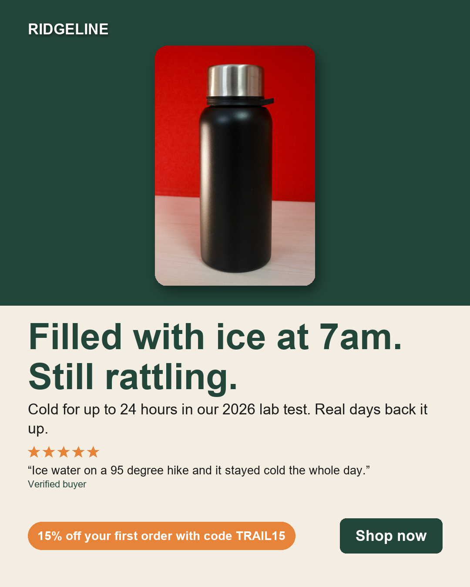
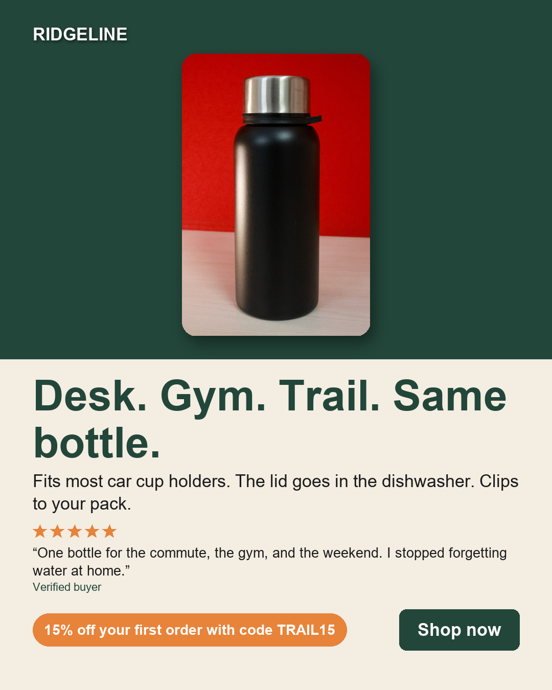
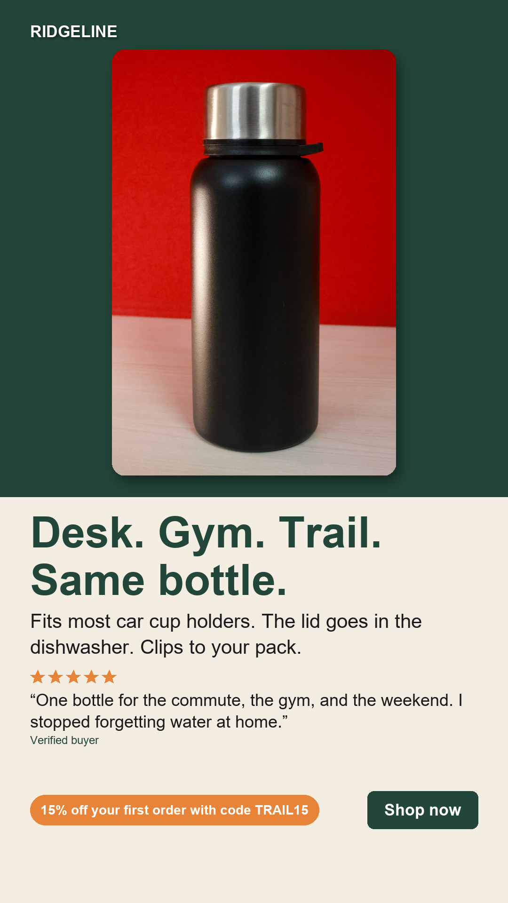
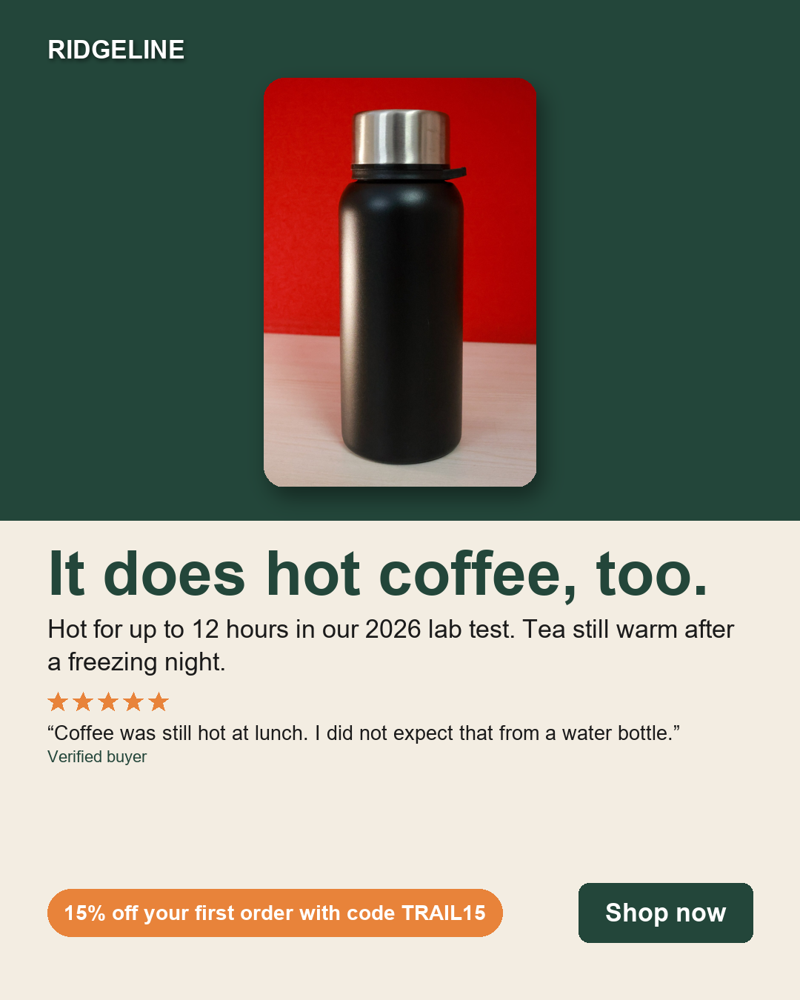
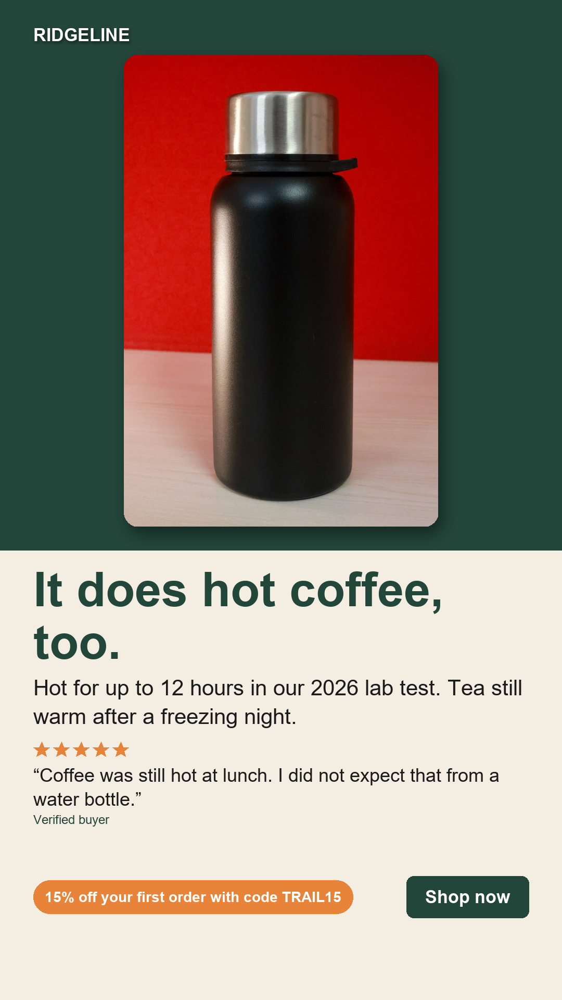
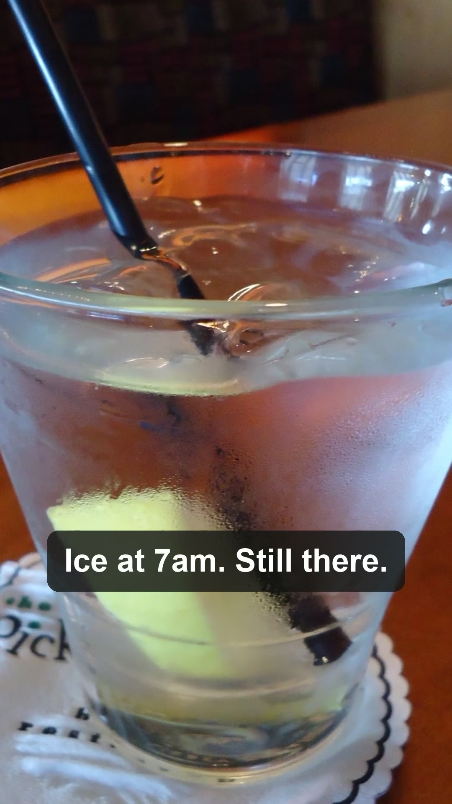

# Sample run: Ridgeline Trail Flask, 24 oz

Brand: **Ridgeline Supply Co.** (fictional sample brand) · run `20261023-220502` · mode `live`  
Models: research `claude-opus-5-5`, writer `claude-opus-5-5`, reviewer `claude-opus-5-5`  
Result: **4 approved, 0 blocked** after 1 review round(s) · 4 LLM calls · 20,868 in / 8,099 out tokens · **$0.2454** · 125.9s

## Finished assets

### A1 · The real-day cold test (approved)

 

### A2 · One bottle, whole week (approved)

 

### A3 · Hot coffee, too (approved)

 

### V1 · video · The real-day cold test (approved)

  
[Watch video/V1_9x16.mp4](video/V1_9x16.mp4) · edit plan: [video/edit_plan.json](video/edit_plan.json) · QA: [video/qa.json](video/qa.json)

## 1. Research agent

> Ridgeline Trail Flask, 24 oz (710 ml), $34.00. Double-wall vacuum insulated 18/8 stainless steel bottle. In Ridgeline's 2026 lab test it kept drinks cold for up to 24 hours and hot for up to 12 hours. It has a leak-resistant screw lid with a carry loop. The narrow 2.9 in (74 mm) base fits most car cup holders. The lid is dishwasher-safe and BPA-free. Powder-coated finish in Forest, Sand, Ember and Slate. Weighs 13.4 oz (380 g). 2-year warranty. Reviews: 18, average 4.11 (ten 5-star, four 4-star, one 3-star, two 2-star, one 1-star). Offer: 15% off your first order with code TRAIL15. CTA: Shop now.

**Tool calls (5), chosen by the agent:**

| # | Tool | Input | Result (preview) |
|---|---|---|---|
| 1 | `get_product` | `{}` | {"title": "Ridgeline Trail Flask, 24 oz", "facts": [{"id": "P-desc", "text": "A 24 oz double-wall vacuum insul… |
| 2 | `get_brand_guide` | `{}` | {"voice": "Plain-spoken, outdoorsy, a little dry. Short sentences. Talks like a friend who hikes, not like an … |
| 3 | `search_reviews` | `{"query": "", "min_rating": 1, "max_rating": 5}` | [{"id": "R01", "rating": 5, "verified": "yes", "text": "Filled it with ice at 7am before a 10 hour shift. Ther… |
| 4 | `review_stats` | `{}` | {"count": 18, "average": 4.11, "distribution": {"5": 10, "4": 4, "3": 1, "2": 2, "1": 1}}… |
| 5 | `get_competitor_ads` | `{}` | [{"id": "C01", "competitor": "SummitSip", "platform": "Instagram", "running_days": 64, "headline": "The last b… |

**Customer language (verbatim, cited):**

- "There was still ice rattling around when I got home." (R01)
- "Finally a bottle that fits the cup holder in my car. My old one rolled around the floor every morning." (R02)
- "Goes from my desk to the gym to the trail on weekends. Same bottle all week." (R03)
- "Coffee was still hot at lunch. I did not expect that from a water bottle." (R05)
- "Ice water on a 95 degree hike and it stayed cold the whole day. Worth it." (R07)
- "I clip it to my pack and forget about it." (R10)

**Recommended angles:**

- **The real-day cold test**: "Filled it with ice at 7am. Still rattling at 7pm." Show ice through a long shift, a 95-degree hike and a hot car. Close with the approved line: cold for up to 24 hours (Ridgeline lab test, 2026). Add TRAIL15 and Shop now. *(R01, R07, R14, B-claim-1, B-claim-3, P-cold_retention)*
- **One bottle, whole week**: "Desk. Gym. Trail. Same bottle." Montage: car cup holder in the morning, desk, gym, clipped to a pack at the weekend. Mention it fits most cup holders and the lid goes in the dishwasher. *(R03, R16, R02, R10, R12, B-claim-4, B-claim-5)*
- **Hot coffee, too**: "Coffee was still hot at lunch. Didn't expect that from a water bottle." Show a morning coffee pour, then lunch, then a cold campsite at dawn with warm tea. Use the approved line: hot for up to 12 hours (Ridgeline lab test, 2026). *(R05, R18, B-claim-2, P-hot_retention)*

**Competitor angles and gaps:**

- SummitSip: Pitches it as the last bottle you'll ever buy: lifetime warranty, 'leak-proof guaranteed', '100% unbreakable'. This ad has run longest of theirs (64 days).. We cannot match any of these. Our warranty is 2 years, the lid is leak-resistant, and reviews mention dents and leaks. The brand guide bans 'leak-proof', 'lifetime warranty' and 'unbreakable'. The gap: honest, specific proof with a warranty that real customers say gets honoured. *(C01, B-claim-7, R04, R06, R15)*
- SummitSip: Big numbers: 'Cold for 36 hours', '2 million hydrated humans'.. Our tested claim is 24 hours. Never match or reference 36 hours, and don't invent customer counts. Real-life proof (shift, hike, hot car) can beat a bigger lab number. *(C02, B-claim-1, R01, R07, R14)*
- AquaCore: Health and wellness: 'Drink more, feel better', 'boosts your energy'. Ran 88 days.. Health and body claims are off-limits for us. Stick to practical benefits like temperature, fit and easy cleaning. *(C03)*
- AquaCore: Influencer unboxing on TikTok: 12 colours, matching straw lids, limited drop.. We have 4 colours and no straw lid, so we can't win on variety. We can show real-life use and the Sand compliment instead. *(C04, P-colours, R13)*
- PeakVessel: Extreme expedition credibility: 'Tested on Everest base camp', $49.. This leaves everyday use uncovered: commute, desk, gym and weekend trail. We are $15 cheaper ($34). Don't copy the Everest claim. *(C05, P-price, R16)*
- Gap: No competitor shows everyday proof (ice after a 10-hour shift, water still cold after a hot car). They lean on big lab numbers or extreme expeditions. (R01, R14, C02, C05)
- Gap: No competitor talks about fitting a car cup holder, and reviewers clearly care about it. (R02, B-claim-4)
- Gap: No competitor mentions a dishwasher-safe lid, even though one reviewer says it's the only reason they still use a bottle every day. (R12, B-claim-5)
- Gap: No competitor talks about hot drinks. Only our customers mention coffee at lunch or tea after a freezing night. (R05, R18, B-claim-2)
- Gap: Competitors overclaim (lifetime, unbreakable, leak-proof, energy). A plain, honest voice and a warranty customers say is honoured stand apart. (C01, C03, R15)
- Gap: Everyday 'one bottle all week' story against PeakVessel's summit-only positioning, at a lower price. (R16, C05, P-price)

**Avoid:**

- 'Leak-proof' or any leak guarantee (banned in the brand guide; minor leaks reported in R04). Use 'leak-resistant' if the lid comes up at all.
- 'Lifetime warranty' and 'last bottle you'll ever buy'. The warranty is 2 years (B-claim-7). This is a SummitSip claim (C01).
- 'Unbreakable', 'indestructible' or any durability guarantee. Reviews report dents and chipped paint (R06, R15).
- 'Best' or any other unsupported superlative (banned in the brand guide).
- Weight loss, 'lose weight' or any health or body claim, including R09's '10 pounds'. Don't use R09 in ads.
- Energy, wellness or 'feel better' hydration claims. These are AquaCore's (C03) and count as health claims.
- Cold for 36 hours or any figure above the tested 24h cold / 12h hot. Always add the lab-test qualifier.
- Customer counts like '2 million' (C02) or any invented social proof. We have 18 reviews averaging 4.11.
- Everest, expedition or 'tested at base camp' claims (C05).
- Claiming 12 colours, straw lids or limited drops (C04). We have 4 colours.
- Saying it fits every cup holder. The approved wording is 'fits most car cup holders'.
- Calling it lightweight. It weighs 13.4 oz and R08 says it's heavier than plastic.
- Hype words or long, salesy copy. The brand voice is plain, dry and uses short sentences.
- Leading with unverified reviews (R06 and R15 are unverified).

## 2. Copywriter and reviewer (agents checking agents)

Each round: the copywriter writes, deterministic checks run, then the reviewer agent reads the copy against the evidence it cites. Failing assets go back to the copywriter with every issue.

| Round | Asset | Checks | Reviewer | Approved | Main issue |
|---|---|---|---|---|---|
| 1 | A1 | 0 issue(s) | 0 issue(s) | yes | - |
| 1 | A2 | 0 issue(s) | 0 issue(s) | yes | - |
| 1 | A3 | 0 issue(s) | 0 issue(s) | yes | - |
| 1 | V1 | 0 issue(s) | 0 issue(s) | yes | - |

Reviewer's last summary: All four assets pass. Every claim matches its cited evidence. Testimonials are verbatim (or verbatim excerpts) from 5-star reviews. The offer and CTA match the brand. No forbidden phrases, competitors, or health claims appear, and the deterministic checks were clean. Only minor b-roll fit notes on V1.

## 3. Final copy and the evidence behind every claim

**A1 · The real-day cold test**  
Headline: Filled with ice at 7am. Still rattling.  
Subhead: Cold for up to 24 hours in our 2026 lab test. Real days back it up.  
Offer: 15% off your first order with code TRAIL15 · CTA: Shop now
Testimonial: "Ice water on a 95 degree hike and it stayed cold the whole day." (R07)

| Claim | Evidence |
|---|---|
| A customer filled it with ice at 7am and still had ice after a 10 hour shift. | `R01` (5 stars) Filled it with ice at 7am before a 10 hour shift. There was still ice rattling around when I got home. |
| Keeps drinks cold for up to 24 hours (Ridgeline lab test, 2026). | `B-claim-1` Keeps drinks cold for up to 24 hours (Ridgeline lab test, 2026) `P-cold_retention` cold_retention: up to 24 hours (Ridgeline lab test, 2026) |
| Customers report it staying cold on a 95 degree hike and in a hot car. | `R07` (5 stars) Ice water on a 95 degree hike and it stayed cold the whole day. Worth it. `R14` (5 stars) Left it in a hot car all afternoon and the water was still cold. That's the test that matters for me. |

**A2 · One bottle, whole week**  
Headline: Desk. Gym. Trail. Same bottle.  
Subhead: Fits most car cup holders. The lid goes in the dishwasher. Clips to your pack.  
Offer: 15% off your first order with code TRAIL15 · CTA: Shop now
Testimonial: "One bottle for the commute, the gym, and the weekend. I stopped forgetting water at home." (R16)

| Claim | Evidence |
|---|---|
| Customers use the same bottle at the desk, the gym and on the trail. | `R03` (4 stars) Goes from my desk to the gym to the trail on weekends. Same bottle all week. Lid is a bit stiff at first. `R16` (5 stars) One bottle for the commute, the gym, and the weekend. I stopped forgetting water at home. |
| Fits most car cup holders. | `B-claim-4` Fits most car cup holders `P-base_diameter` base_diameter: 2.9 in (74 mm) |
| Dishwasher-safe lid. | `B-claim-5` Dishwasher-safe lid |
| Carry loop clips to a pack. | `P-desc` A 24 oz double-wall vacuum insulated bottle in 18/8 stainless steel. Keeps drinks cold for up to 24 hours and hot for up `R10` (5 stars) The carry loop is great. I clip it to my pack and forget about it. |

**A3 · Hot coffee, too**  
Headline: It does hot coffee, too.  
Subhead: Hot for up to 12 hours in our 2026 lab test. Tea still warm after a freezing night.  
Offer: 15% off your first order with code TRAIL15 · CTA: Shop now
Testimonial: "Coffee was still hot at lunch. I did not expect that from a water bottle." (R05)

| Claim | Evidence |
|---|---|
| Keeps drinks hot for up to 12 hours (Ridgeline lab test, 2026). | `B-claim-2` Keeps drinks hot for up to 12 hours (Ridgeline lab test, 2026) `P-hot_retention` hot_retention: up to 12 hours (Ridgeline lab test, 2026) |
| A camper's tea was still warm in the morning after a night below freezing. | `R18` (5 stars) Camping trip, below freezing at night, tea was still warm in the morning. |

**V1 · video script · The real-day cold test**

| Beat | Voiceover | Caption | B-roll | Evidence |
|---|---|---|---|---|
| 1 | Filled it with ice at 7am. Still rattling after the shift. | Ice at 7am. Still there. | `broll_ice` | R01 |
| 2 | Ninety-five degree hike. Ice water stayed cold the whole day. | Cold all day on a 95° hike | `broll_trail` | R07 |
| 3 | Left in a hot car all afternoon. Water still cold. | Hot car. Still cold water. | `broll_road` | R14 |
| 4 | Same bottle at the gym. And the lid goes in the dishwasher. | Gym too. Lid: dishwasher. | `broll_gym` | R03, B-claim-5 |
| 5 | Cold for up to 24 hours in our 2026 lab test. | Cold up to 24 hrs (lab test) | `broll_ice` | B-claim-1, P-cold_retention |
| end | | One bottle. Cold all day. + offer + CTA | `end_card` | |

## 4. Integrations

Dry-run payloads (no credentials set for this sample run) are in [integrations/](integrations/): Shopify product fetch, Meta Ads (each approved ad created **PAUSED**), Google Drive uploads, Notion tracker rows, Slack summary.

## 5. Monitoring

Every step is timed and logged to [run.jsonl](run.jsonl); a failure posts a Slack alert.

| Step | Status | Seconds |
|---|---|---|
| load brand + product | ok | 0.0 |
| research agent | ok | 40.34 |
| copywriter round 1 | ok | 32.43 |
| checks + reviewer round 1 | ok | 11.13 |
| static ad engine | ok | 2.59 |
| video editor | ok | 39.18 |
| publish | ok | 0.01 |
